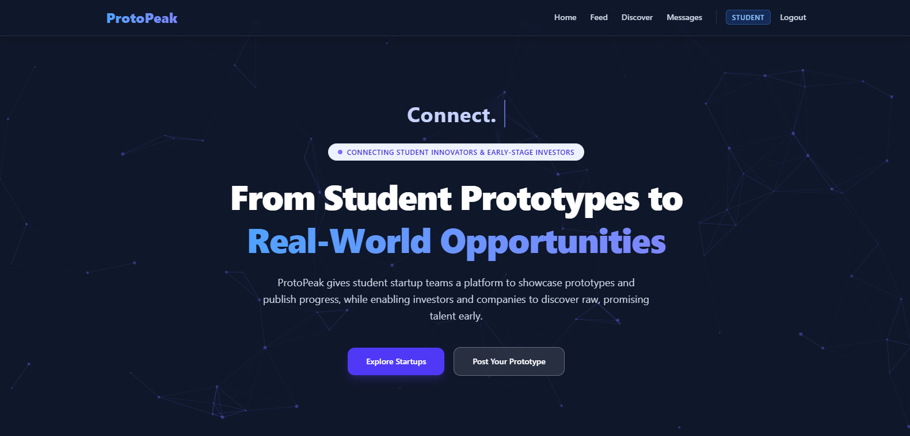

# ▲ ProtoPeak



## 👤 Team members:
* **Sadhana**
* **Shrusti**
* **Syed Zaki**
* **Varun**

## Installation & Setup (Local)

```bash
# 1️⃣ Clone the repository
git clone https://github.com/Varun04-pixel/ProtoPeak.git
cd ProtoPeak

# 2️⃣ Backend setup
cd server
npm install

# Create a .env file inside Backend/  and add this:
MONGO_URI=your_mongodb_connection_string
PORT=5000
JWT_SECRET=some_secret_code (combination of numbers, symbols, alphabets)

# Start backend
nodemon server.js

# 3️⃣ Frontend setup (in a new terminal, while backend is running)
cd client
npm install

# Start frontend
npm run dev

# 4️⃣ Open the app
Frontend → http://localhost:5173
Backend  → http://localhost:5000